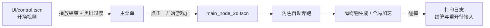

# 🎵 D2 Music Running

> 一款基于 Godot 4 的 2D 音乐无尽跑酷原型。角色在像素校园中自动奔跑，伴随 BGM 不断加速，跳过迎面而来的障碍物。


## 项目简介

`D2MusicRunning` 是一个以“音乐 + 跑酷”为主题的 Godot 2D 无尽跑酷原型。它没有复杂的关卡系统，核心体验是：

- 角色固定在屏幕左侧原地奔跑；
- 障碍物按随机间隔从右侧生成并向左移动；
- 玩家通过跳跃、二段跳和空中快速下落躲避障碍；
- 游戏时间越长，全局速度倍率越高，角色动画、障碍物速度、生成频率和背景视差一起变快；
- 主菜单与游戏内使用不同 BGM，开场还有一段静音视频。

当前版本已经打通“开场视频 → 主菜单 → 游戏场景 → 障碍物循环”的核心流程，但计分、失败结算和重新开始尚未接入，属于可玩原型阶段。

| 项目 | 内容 |
| --- | --- |
| 引擎 | Godot 4.7 |
| 语言 | GDScript |
| 渲染器 | GL Compatibility |
| 主场景 | `UI/control.tscn` |
| 目标平台 | 桌面端 / Web |

## 玩法与操作

| 操作 | 键盘 | 触屏 / 鼠标 |
| --- | --- | --- |
| 跳跃 | `W` | 点击/触摸屏幕上方区域 |
| 二段跳 | 空中再按 `W` | 空中再次点击上方区域 |
| 快速下落 | 空中按住 `S` | 按住屏幕下方区域 |

补充说明：

- 角色不会横向移动。`A` / `D` 虽然写在输入映射里，但当前角色控制器没有使用。
- 快速下落只在空中生效，落地后自动取消。
- 二段跳需要在首次跳跃后约 `0.05s` 才能触发，且高度明显低于一段跳。
- 触屏按钮通过 `TouchScreenButton` 映射到 `jump` / `roll` 两个 Input Action；桌面端开启了鼠标模拟触控。

## 游戏流程



主场景是 `UI/control.tscn`，对应 `project.godot` 中的 `run/main_scene`。开场视频 `video/video_final.ogv` 为 1920×1080、约 5 秒、音量设为 `-80 dB`（基本静音）；播放结束后通过 `FadeOverlay` 黑屏过渡，显示主菜单。

## 功能特性

- [x] 开场视频 + 淡入淡出主菜单
- [x] 2D 自动奔跑角色与序列帧动画
- [x] 单跳、二段跳、空中快速下落
- [x] 随机间隔障碍物生成
- [x] 障碍物左移、离屏回收与 Q 弹挤压形变
- [x] 全局速度倍率随时间提升
- [x] 地面 / 背景视差滚动
- [x] 菜单 BGM 与游戏 BGM 切换
- [x] Web 导出预设与 HTML 构建压缩插件
- [ ] 计分、最高分与结算界面
- [ ] 碰撞后的游戏结束与重新开始
- [ ] 暂停、设置、音量 / 音乐开关
- [ ] 更完整的移动端 UI 与适配

## 项目结构

```text
.
├─ project.godot                 # Godot 项目配置（4.7 / GL Compatibility）
├─ GameManager.gd                # Autoload：全局速度与游戏状态
├─ audio_manager.gd/.tscn        # Autoload：菜单/游戏双 BGM
├─ main_node_2d.tscn/.gd         # 游戏主场景：启动加速、播放游戏 BGM
├─ StartMenu.gd                  # 旧版菜单脚本（当前未挂载）
├─ UI/
│  ├─ control.tscn               # 启动场景：视频 → 菜单
│  └─ control.gd
├─ character/
│  ├─ character_0.tscn           # 角色场景与 run 动画帧
│  └─ character_body_2d.gd       # 跳跃 / 二段跳 / 快速下落
├─ Spawner/
│  ├─ Spawner.tscn
│  └─ spawner.gd                 # 定时生成障碍物
├─ Obstacle/
│  ├─ Obstacle_test.tscn
│  ├─ obstacle_test.gd           # 左移、Q 弹形变、碰撞检测
│  └─ 复古像素风障碍物素材表.png
├─ scenes/
│  ├─ ground_0/                  # 地面视差、碰撞体、边缘淡出 shader
│  └─ background/                # 背景视差滚动
├─ pictures/                     # 角色、背景、UI 素材
├─ music/                        # 菜单与游戏 BGM
├─ video/                        # 开场视频与备用视频
└─ addons/
   ├─ minimize_html_build/       # 已启用：Web 构建压缩
   └─ sprite_staticbody_builder/ # 精灵碰撞体 / 阴影生成工具（未启用）
```

## 核心系统

### 1. 全局速度：`GameManager`

`GameManager` 是 Autoload 单例，维护以下关键状态：

| 变量 | 默认值 | 说明 |
| --- | --- | --- |
| `current_speed` | `1.0` | 当前全局速度倍率 |
| `max_speed` | `5.0` | 速度上限 |
| `speed_acceleration` | `0.05` | 每秒增加的倍率 |
| `is_game_running` | `false` | 只有为 `true` 时才加速 |
| `enable_obstacle_anim` | `false` | 是否播放障碍物 Q 弹动画 |

游戏运行时，`current_speed` 以 `0.05/s` 递增，约 80 秒到达 5 倍上限。这个倍率会被以下系统读取：

- 角色 `AnimatedSprite2D.speed_scale`
- 障碍物移动速度
- 障碍物生成间隔
- 地面 `Parallax2D.autoscroll`
- 背景 `region_rect` 滚动速度

### 2. 角色控制：`character_body_2d.gd`

- 角色是 `CharacterBody2D`，但横向速度被固定为 `0`，实际是“原地跑 + 场景滚动”的表现方式。
- 重力 `3500`，一段跳初速度 `-1300`，二段跳初速度 `-353`。
- 空中按住 `roll`（`S`）时，重力切换为 `20000`，实现快速落地。
- 落地后重置二段跳状态。
- `run` 动画为 22 帧循环，基准 30 FPS，运行时通过 `speed_scale` 跟随全局速度。

### 3. 障碍物与生成器

`Spawner/spawner.gd`：

- 场景启动时 `Timer` 自动开始，首次等待 2 秒。
- 每次超时实例化 `Obstacle_test.tscn`，生成坐标默认 `(1270, 500)`。
- 下一次等待时间为：

```gdscript
timer.wait_time = randf_range(1, 5) / GameManager.current_speed
```

- 障碍物作为 Spawner 的子节点加入场景。

`Obstacle/obstacle_test.gd`：

- `Area2D`，以 `400 * current_speed` 的速度向左移动。
- `position.x < -100` 时执行 `queue_free()`。
- 通过正弦波让精灵在 X 轴挤压、Y 轴拉长，形成 Q 弹效果。
- `body_entered` 检测到 `CharacterBody2D` 后打印日志；真正的“结束游戏 / 重载场景”代码目前是注释状态。

### 4. 视差场景

- 地面：`scenes/ground_0/ground_0.tscn`
  - 根节点为 `Parallax2D`，`repeat_size = (1200, 0)`。
  - `ground_0.gd` 用 `base_autoscroll_speed = (-30, 0)` 驱动自动滚动，未开始游戏时停止。
  - `ground_0.gdshader` 根据 `REGION_RECT` 对上下边缘做柔和淡出。
  - 子节点 `StaticBody2D` 提供地面碰撞。
- 背景：`scenes/background/background_00.tscn`
  - 根节点 `Parallax2D`，`repeat_size = (1380, 0)`。
  - `back_00.gd` 通过移动 `Sprite2D.region_rect.position.x` 实现滚动，基础速度 `20`。
  - `background_00.gd` 目前为空文件。

### 5. 音频与菜单

- `AudioManager` 是 Autoload `CanvasLayer`，包含两个 `AudioStreamPlayer`：
  - `rainlove`：菜单 BGM《雨爱四凤》，启动时自动播放，音量 `-8.465 dB`。
  - `AudioStreamPlayer`：游戏 BGM《活跃黑江乐 - 「邦友的酒(DJ版)」梦的结唱halo [exhigh]》，`pitch_scale = 0.99`。
- `play_music()`：停止菜单 BGM，开始游戏 BGM。
- `toggle_music()` / `is_music_playing()` 已实现，但当前没有 UI 调用。
- 主菜单按钮逻辑在 `UI/control.gd`，点击后切换到 `res://main_node_2d.tscn`。

## 参数速查

| 想调整什么 | 文件 | 参数 |
| --- | --- | --- |
| 速度上限 / 加速度 | `GameManager.gd` | `max_speed`、`speed_acceleration` |
| 跳跃高度 | `character/character_body_2d.gd` | `jump_velocity` |
| 二段跳高度 / 延迟 | `character/character_body_2d.gd` | `double_jump_velocity`、`double_jump_delay` |
| 快速下落速度 | `character/character_body_2d.gd` | `fast_fall_gravity` |
| 障碍物基础速度 | `Obstacle/obstacle_test.gd` | `base_speed` |
| Q 弹幅度 / 频率 | `Obstacle/obstacle_test.gd` | `squash_amount`、`height_grow_amount`、`squash_speed` |
| 生成位置 / 缩放 | `Spawner/spawner.gd` | `spawn_position`、`obstacle_scale` |
| 生成间隔 | `Spawner/spawner.gd` | `randf_range(1, 5) / current_speed` |
| 地面滚动速度 | `scenes/ground_0/ground_0.gd` | `base_autoscroll_speed` |
| 背景滚动速度 | `scenes/background/back_00.gd` | `base_scroll_speed` |

## 运行方式

### 环境要求

- Godot **4.7**（建议使用 4.7.x；标准版即可，项目逻辑全部为 GDScript）
- 渲染器：`GL Compatibility`
- 无需额外构建步骤或第三方依赖

### 本地运行

```bash
git clone https://github.com/Kaatou520/my-godot-runner.git
cd my-godot-runner
```

1. 用 Godot 打开 `project.godot`。
2. 按 `F5` 运行。
3. 主场景会先播放约 5 秒开场视频，视频结束后进入主菜单。
4. 点击「开始游戏」进入跑酷场景。

### 导出 Web

项目已包含 `Web` 导出预设，并启用了 `addons/minimize_html_build`：

1. 打开 `Project > Export...`，选择 `Web`。
2. 将导出路径改为你自己的目录（`export_presets.cfg` 中当前是作者本机的绝对路径）。
3. 导出后用本地 HTTP 服务打开，例如：

```bash
python -m http.server 8000
```

然后访问 `http://localhost:8000`。不要直接双击 `index.html`，浏览器通常不允许 `file://` 下的 WebAssembly / 资源加载。

`Minimize HTML Build` 会在导出时自动压缩 `.pck`、`.wasm`，并压缩/精简 `.html`、`.js`，用于改善加载速度。

## 当前状态与已知问题

当前版本适合用来演示核心跑酷循环和场景组织，还不是完整游戏。已知问题 / 待办：

- **碰撞结算未接入**：`obstacle_test.gd` 只打印 `游戏结束！`，`reload_current_scene()` 和 `is_game_running = false` 仍然是注释。
- **没有计分系统**：目前没有分数、最高分或距离统计。
- **没有失败 / 重开界面**：需要补一个 Game Over UI 和重开按钮。
- **菜单占位内容**：`UI/control.tscn` 中仍有 `Label` 文本 `hi`；`button_down` 信号连接到未实现的 `_on_button_button_down`，在编辑器中可能看到连接警告。
- **旧菜单脚本未使用**：根目录 `StartMenu.gd` 当前没有挂载到任何场景，实际菜单逻辑在 `UI/control.gd`。
- **音乐开关未接线**：`AudioManager.toggle_music()` 已实现，但没有对应按钮。
- **障碍物动画开关存在冗余**：`main_node_2d.gd` 在场景加载时已将 `enable_obstacle_anim` 设为 `true`，因此障碍物从一开始就会 Q 弹；`obstacle_test.gd` 中“撞到第一个障碍物才开启”的分支目前不会产生额外视觉变化。
- **导出路径是本机绝对路径**：`export_presets.cfg` 的 `export_path` 指向作者电脑上的目录，导出前需要修改。
- **部分文件为占位 / 遗留**：`scenes/background/background_00.gd` 为空；`godot-minimize-html-build-1.1.4/` 下的 `addons` 目录为空；`video/` 中还有未使用的 `output.ogv` 和 `video.mp4`。
- **插件启用情况**：`minimize_html_build` 已在 `project.godot` 中启用；`sprite_staticbody_builder` 随仓库提供但未启用。

## 第三方组件与素材

### Addons

- **Minimize HTML Build**：Web 导出压缩 / 精简，已启用。许可证见 `addons/minimize_html_build/LICENSE`。
- **Sprite StaticBody Builder**：从精灵纹理生成 `StaticBody2D` 碰撞体和实时阴影的工具，当前未启用。许可证见 `addons/sprite_staticbody_builder/LICENSE`。

### 素材版权

> [!IMPORTANT]
> 角色序列帧、背景、UI 图片、音乐和视频分别位于 `pictures/`、`music/`、`video/`。这些素材的版权归各自原作者 / 权利人所有，仓库未附带单独的素材授权文件。如果计划公开发布、商用或再分发，请先确认音乐、角色和美术素材的授权，或替换为可用的原创 / 授权素材。

仓库目前没有根级 `LICENSE` 文件；代码复用前请先联系仓库作者确认授权方式。

## 仓库与反馈

- GitHub：<https://github.com/Kaatou520/my-godot-runner>
- 引擎：[Godot Engine](https://godotengine.org/)
- 如果发现 bug 或有改进建议，欢迎在 GitHub 提交 Issue。

---

以上内容可直接保存为项目根目录的 `README.md`。